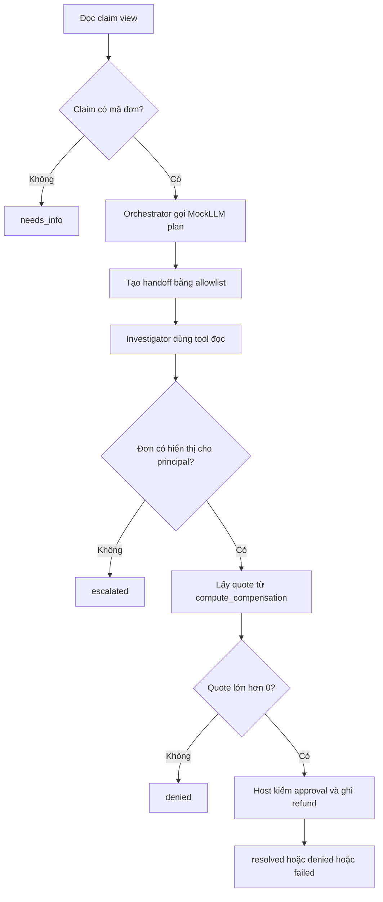

# Bàn giao C: Orchestrator — Chu Quang Linh

- Thành viên: Chu Quang Linh — 2A202603809.
- Commit code/test: `a42312c`.
- Nền starter: `034c6c4`; nguồn draft Orchestrator/test: `develop` tại `f9a6c80`.
- File triển khai: `src/lab8/shapes/orchestrator.py`.
- File test: `src/tests/test_orchestrator_shape.py`.

## Phạm vi

Bàn giao một orchestrator và một investigator chỉ đọc. Không bao gồm Workflow, Single, benchmark chung, ADR, research card hoặc ablation. Giữ nguyên chữ ký `run_claim(claim_id, *, seed, store_path, crash_at=None) -> RunResult` và không sửa host, policy, metrics, config hay dữ liệu đề bài.

## Luồng xử lý



Claim không tồn tại trả `failed`. Mọi nhánh trả kết quả dùng `finish()`. Khi host phát `InjectedCrash`, shape ghi trace rồi ném lại lỗi để bên gọi thực hiện resume.

Investigator chạy các tool theo thứ tự `lookup_order`, `lookup_policy`, `lookup_refund_history`, `compute_compensation`. Tool quote dùng order có cấu trúc từ lookup; không lấy số ngày hoặc số tiền trong ticket. Nếu báo cáo không có quote dùng được, orchestrator tự gọi tool tính lại.

## Ranh giới code, model và host

| Thành phần | Quyền và trách nhiệm |
| --- | --- |
| Orchestrator | Đọc claim, định tuyến, tạo handoff, nhận báo cáo, gọi host |
| Investigator | Nhận handoff đã lọc; tool được dispatch với `worker=True`, chỉ đọc |
| MockLLM | Các lần gọi `plan`, `investigate`, `draft`; không quyết số tiền hoặc tự tạo approval |
| Tool tính tiền | Tính quote từ dữ liệu order và policy theo luật nghiệp vụ |
| Host | Kiểm approval đúng claim, cap theo approved/paid và theo đơn, idempotency, transaction và audit |

Orchestrator truyền **quote đầy đủ** vào host. Ví dụ entitlement mới 150.000 VND và đơn từng hoàn 30.000 VND: truyền 150.000, host tự quyết khoản ghi thêm 120.000. Nếu approval hỏng nhưng quote dương, vẫn gọi host để host từ chối và ghi `policy_denied`.

## Handoff và trace

`make_handoff` tạo payload `handoff.v1` với `request_id`, `claim_id`, task, `facts={}` và allowlist bốn tool đọc. Không gửi ticket, claim row thô, secret, raw header hoặc tool ghi. Principal được truyền cho runner qua tham số riêng để scope truy cập order; không ghi vào trace.

Trace gồm `claim`, `handoff`, `investigator`, `quote`, `host`, `result`; thêm `quote_recomputed` hoặc `crash` khi có tình huống tương ứng. Chỉ giữ cờ định tuyến, handoff đã sanitize, các field order cần quyết định, số tiền và lý do. Không ghi ticket, prompt, output model, phone, address, internal note hoặc item name. File runtime nằm trong `traces/` và không commit.

## Cách kiểm chứng

Chạy từ `src/` sau khi cài dependencies:

```powershell
python -m pytest -q
python -m pytest -q -m student -o addopts= -k orchestrator
```

Kết quả chạy lại trên Python 3.12.6/Windows: lần lượt **63 passed, 248 deselected** và **62 passed, 249 deselected**. Test bổ sung kiểm allowlist và quyền đọc, không đưa ticket vào model investigator, trace sạch, host chặn approval sai claim có audit, và fallback khi thiếu quote. T11/T12 của ma trận student kiểm retry/crash-resume.

Không chạy toàn bộ ma trận student để kết luận cả nhóm đã hoàn thành: hai shape khác đang là stub. `check_submission` của toàn nhóm cũng cần benchmark, crash report và các báo cáo chung được leader hoàn thiện sau tích hợp.

## Giới hạn và lưu ý tích hợp

- Kế hoạch và tool được Python cố định; output MockLLM không điều khiển luồng. Không dùng kết quả này để khẳng định model có khả năng lập kế hoạch tự chủ.
- Model `plan` ở parent có nhận ticket; model investigator chỉ nhận handoff. Không coi việc tóm tắt bằng model là redaction.
- Quote hợp lệ từ tool investigator chưa được verifier độc lập tính lại; fallback chỉ xử lý quote thiếu hoặc thiếu khóa `amount_vnd`.
- Giữ nguyên full quote, việc ném lại `InjectedCrash`, đóng connection trong `finally` và các nhánh `finish()` khi tích hợp.
- Chưa có hidden chính thức; leader cần đo cả bốn shape cùng claim/seed, tạo report bắt buộc, điền ADR và research card. Không lấy số liệu nhánh draft thay cho lần chạy của bản tích hợp cuối.

## Checklist bàn giao

- [x] Code C và test bổ sung đã có commit kỹ thuật.
- [x] Test mặc định và 62 test student riêng C xanh.
- [x] Mô tả luồng, quyền, handoff, trace và giới hạn.
- [x] Báo cáo cá nhân và dòng đóng góp trong `TEAM.md`.
- [ ] Thành viên tự chạy lại và chuẩn bị giải thích khi bảo vệ.
- [ ] Leader tích hợp vào bài nhóm và kiểm tra trước khi nộp.
